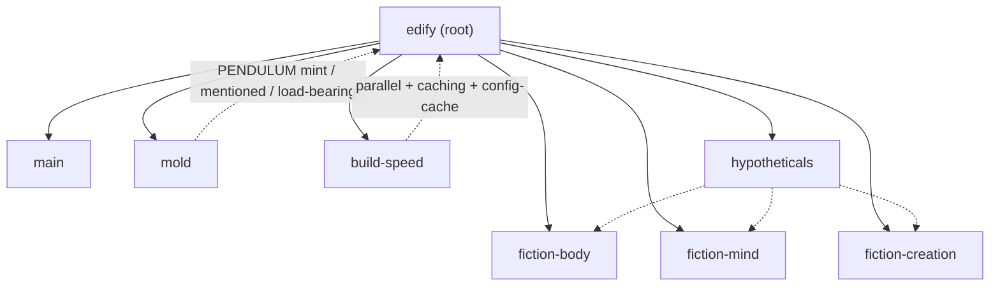

# Edify

Edify is the root system: one branch that joins `main` with every other living branch so fiction, mold, and build speed share one trunk.

## Root map

## Rules

- **Non-load-bearing** text: every ASCII `0` becomes `ơ` (or `ọ` when the previous character was `1`).
- **Load-bearing** paths (`app/`, `gradle/`, `python/`, `generated_modules/`, `.githooks/`, `compose/`, Gradle scripts/properties, wrapper): keep real zeros so `./gradlew assembleDebug` and the Python demos still run. `PENDULUM.py` reports those files as `load-bearing`.
- Fiction under `hypotheticals/` is kept from every fiction branch; `resonance_noise_fiction.py` is unified under the edify salt set.
