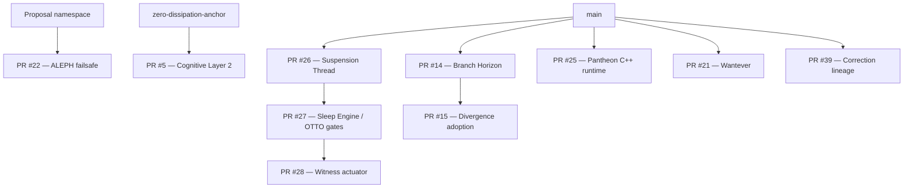

# ERIA Branch Directory — Acoustic Transmission Cross-Reference

**Document type:** Branch inventory and semantic signal-path index  
**Baseline:** `main` at `712961866e615ff4db9e90cd40bece78a45afe39`  
**Purpose:** Describe how branch identities, transmission contracts, and review dependencies relate without conflating them.

> A branch is a distinct source channel. A cross-reference is a traceable connection, not a merge. A receipt proves a recorded exchange, not permission to act.

## 1. Acoustic reading of the repository

“Acoustic” is used here as an architectural metaphor for ordered signal movement and return evidence. It does not claim that Git branches emit sound, that repository metadata is an audio waveform, or that software transmission changes physical systems.

The transmission contract provides this semantic path:

`Source → Capture → Encode → Internal Transceiver → Local Endpoint → Return Receipt`

Read the repository through the same stages:

| Transmission stage | Repository meaning | Required evidence |
|---|---|---|
| Source | Original branch, commit, file, or authored record | Exact branch/ref and commit SHA |
| Capture | Snapshot of the source tree or PR head | Inspected head SHA and captured file list |
| Encode | Review description, manifest, digest, or typed change record | Schema/version, operation, digest where applicable |
| Internal transceiver | Proposed cross-branch relationship or pull request | Explicit base, head, and dependency edges |
| Local endpoint | Intended receiving branch or reviewed integration target | Receiver branch identity and compatibility review |
| Return receipt | CI result, review, merge commit, or recorded hold | Exact run/review/merge reference and outcome |

A detected branch, matching name, green check, digest, or transmission receipt is not by itself an authorization to merge, dispatch, publish, or execute.

## 2. Cross-reference rules

1. Keep branch names, commit identities, and PR identities distinct.
2. Preserve the source branch and its ancestry when integrating; prefer merge commits where ancestry must remain visible.
3. A stacked PR must follow its parent: integrate the parent into its declared base before integrating its child.
4. Do not retarget a child merely to make a merge button available. First verify that the child diff still represents only its intended incremental change.
5. Record each transition as `from → to`, with exact refs and SHAs.
6. A reverse correction is a new linked record; it never erases the earlier forward record.
7. Keep unresolved, draft, stale-base, and non-mergeable states visible. Do not convert them into “ready” by wording.
8. Keep local transmission distinct from network, webhook, Bluetooth, remote-device, and physical-actuator dispatch. Those require separate adapters, scope, authorization, and tests.
9. If a branch or PR cannot be inspected, label its status unknown rather than inferring from its name.
10. This directory is an inventory, not merge authorization or a command to converge every branch.

## 3. Live branch inventory

The following names were returned by the repository branch listing at the baseline inspection. Names establish that refs were listed; they do not establish current content, CI health, or merge readiness. Recheck the live ref before any write.

### Main and historical anchors

| Ref | Role in this directory |
|---|---|
| `main` | Default integration line; baseline SHA above |
| `main-11-of-38` | Historical Main-line marker |
| `archive/justly-11-merge` | Preserved original @11 merge anchor |
| `archive/main-before-1999-timestamp` | Historical archive ref |
| `history` | Historical source line |
| `zero-dissipation-anchor` | Separate provenance/governance base |
| `migration/eria-identity` | ERIA identity migration line |

### Application, transmission, and integration channels

| Ref | Cross-reference |
|---|---|
| `integration/skribed-transmission-main-anchor` | Original SKRIBED/transmission integration source for PR #38; #38 is already merged |
| `feature/eria-correction-lineage-runtime` | PR #39; correction journal, forward/reverse tiers, and future marker anchor |
| `integration/channel-router-main` | PR #7; local permission-checked channel router |
| `integration/git-freedom-router` | PR #9; Git Freedom router candidate |
| `integration/wantever-propagation` | PR #21; Wantever propagation contract |
| `integration/olpirt-stride-next` | PR #20; Stride reconciliation candidate |
| `automation/android-dependency-updates` | Dependency update automation |
| `build-speed` | Build configuration line |
| `Vanellye-patch-1` | Earlier patch line |

### ERIA / Pantheon dependency channels

| Ref | Cross-reference |
|---|---|
| `eria/suspension-thread-player-adapter` | PR #26; parent of the OTTO trigger stack |
| `eria/otto-external-action-gates` | PR #27; child of #26 and parent of #28 |
| `eria/witness-noise-actuator` | PR #28; child of #27 |
| `eria/pantheon-cpp-runtime-copy` | PR #25; isolated C++ runtime candidate |
| `feature/aleph-origin-failsafe` | PR #22 head; based on the proposal namespace branch |
| `proposal/eria-yes-no-double-anchor-namespace` | PR #22 declared base |
| `pantheon/branch-horizon` | PR #14 head; parent of PR #15 |
| `pantheon/divergence-adoption` | PR #15; child of #14 |
| `pantheon/signed-package-exchange` | PR #13 |
| `pantheon/source-digest-engine` | PR #11 |
| `pantheon/cpp-html-consent-engine` | Pantheon consent-engine branch |
| `eria/pantheon-runtime-review-gate` | Pantheon runtime review-gate line |
| `eria/new-pantheon-staging` | Earlier Pantheon staging line |
| `pantheon/branch-horizon` | Branch comparison and review workflow |
| `pantheon/cpp-html-consent-engine` | Consent-engine implementation line |

### Knowledge, fiction, and research channels

| Ref | Classification |
|---|---|
| `knowledge-recycle-foundation` | Knowledge/provenance foundation; PR #17 |
| `cognitive-layer-2` | Append-only cognitive-memory proposal; PR #5 |
| `leveled-consciousness` | Data-envelope implementation line |
| `hypotheticals` | Hypothesis-only material |
| `fiction-body` | Fiction source; not empirical evidence |
| `fiction-creation` | Fiction source; not empirical evidence |
| `fiction-mind` | Fiction source; not empirical evidence |
| `heroes-raw` | Raw narrative/source line |
| `edify` | Edification/consolidation line |
| `mold` | Earlier source line |
| `light` | Named exploratory line |
| `transcendence` | Named exploratory line |
| `transmission` | Named transmission line |
| `feature/ashes-to-angels-pheonix` | Named feature line; spelling retained as listed |
| `repair/quarantine-legacy-python-syntax` | Quarantine/repair record |
| `review/legacy-syntax-quarantine` | PR #8 review-only quarantine record |
| `review/two-snapshot-synthesis` | Snapshot synthesis review line |

### Automation and dependency-maintenance channels

| Ref | Role |
|---|---|
| `dependabot/github_actions/main/actions/checkout-7` | Automated dependency proposal |
| `dependabot/github_actions/main/actions/setup-java-6` | Automated dependency proposal |
| `dependabot/github_actions/main/actions/setup-python-7` | Automated dependency proposal |
| `dependabot/gradle/main/androidx.compose-compose-bom-2026.09.00` | Automated dependency proposal |
| `dependabot/gradle/main/com.android.application-9.5.1` | Automated dependency proposal |
| `dependabot/gradle/main/gradle-wrapper-9.9.0` | Automated dependency proposal |
| `dependabot/gradle/main/org.jetbrains.kotlin.plugin.compose-2.4.21` | Automated dependency proposal |
| `dependabot/gradle/main/org.jetbrains.kotlinx-kotlinx-coroutines-android-1.11.0` | Automated dependency proposal |

## 4. Pull-request transmission graph

The following graph reflects declared PR base/head relationships observed during inventory. It is not a statement that any open PR has been merged.



### Required merge sequence for known stacks

- **Suspension/OTTO stack:** #26 → #27 → #28.
- **Branch Horizon stack:** #14 → #15.
- **ALEPH lineage:** inspect and preserve the proposal namespace base before considering #22.
- **Cognitive Layer 2:** retain the distinct `zero-dissipation-anchor` base when evaluating #5.

For each child, re-fetch PR metadata and compare the child head with its declared base after the parent is integrated. If the child diff now contains duplicated parent commits or unrelated changes, stop and reconcile in a new reviewable commit/PR. Never force-update the child to conceal divergence.

## 5. Open PR status snapshot

The following open PRs were visible during this directory rewrite. Draft and mergeability states can change; re-fetch before action.

| PR | Base → head | Snapshot state |
|---|---|---|
| #39 | `main` → `feature/eria-correction-lineage-runtime` | Draft; reported mergeable |
| #28 | `eria/otto-external-action-gates` → `eria/witness-noise-actuator` | Draft; reported mergeable |
| #27 | `eria/suspension-thread-player-adapter` → `eria/otto-external-action-gates` | Draft; reported mergeable |
| #26 | `main` → `eria/suspension-thread-player-adapter` | Draft; reported mergeable |
| #25 | `main` → `eria/pantheon-cpp-runtime-copy` | Draft; reported mergeable |
| #22 | `proposal/eria-yes-no-double-anchor-namespace` → `feature/aleph-origin-failsafe` | Draft; reported mergeable |
| #21 | `main` → `integration/wantever-propagation` | Open; reported mergeable |
| #20 | `main` → `integration/olpirt-stride-next` | Draft; reported non-mergeable |
| #17 | `main` → `knowledge-recycle-foundation` | Draft; reported non-mergeable |
| #15 | `pantheon/branch-horizon` → `pantheon/divergence-adoption` | Draft; reported non-mergeable |
| #14 | `main` → `pantheon/branch-horizon` | Draft; reported non-mergeable |
| #13 | `main` → `pantheon/signed-package-exchange` | Draft; reported non-mergeable |
| #11 | `main` → `pantheon/source-digest-engine` | Draft; reported non-mergeable |
| #9 | `main` → `integration/git-freedom-router` | Draft; reported non-mergeable |
| #8 | `main` → `review/legacy-syntax-quarantine` | Draft; reported non-mergeable |
| #7 | `main` → `integration/channel-router-main` | Draft; reported non-mergeable |
| #5 | `zero-dissipation-anchor` → `cognitive-layer-2` | Draft; reported mergeable |

PR #38 is already merged and remains the historical transmission integration associated with @11. Its original merge commit is `b60fac42ba0573c251cf7f7fe139bfa0f9c078f8`.

## 6. Transmission contracts and their limits

The SKRIBED/transmission implementation currently documents an in-process path:

- Preserve original authored text and its UTF-8 bytes.
- Carry transmission ID, correlation ID, source reference, exact payload bytes, and SHA-256 digest.
- Defensively copy frame payloads and verify integrity before endpoint delivery.
- Return a correlated receipt containing source/correlation identity and request/response digests.
- Convert explicitly supplied signed PCM16 little-endian samples to local WAV data.
- Keep WAV file creation and local playback as separate explicit calls.

This is a local software contract. It does **not** implement network sockets, webhooks, Bluetooth routing, installed-player routing, remote-device delivery, automatic playback, or hardware actuation. A future external adapter must independently define destination identity, consent, authentication, replay protection, idempotency, quality checks, approval scope, and recovery behavior.

A digest is an integrity fingerprint, not proof of truth, signer identity, or authorization. A return receipt proves that the documented endpoint returned a response, not that an external listener received or understood it.

## 7. Cross-reference record format

Use this record whenever one branch consumes or derives from another:

```yaml
cross_reference_id: "ERIA-XREF-<unique-id>"
source:
  branch: "<exact source branch>"
  commit: "<full source SHA>"
  path: "<source path or contract>"
transmission:
  contract: "in-process | reviewed-pr | external-adapter"
  direction: "source-to-receiver"
  payload_digest: "<sha256 or pending>"
  correlation_id: "<id or pending>"
receiver:
  branch: "<exact receiving branch>"
  base_commit: "<full SHA>"
  expected_change: "<bounded change>"
return_receipt:
  type: "ci | review | merge | hold"
  reference: "<exact URL or pending>"
  outcome: "passed | failed | pending | blocked"
authorization:
  scope: "review-only"
  external_dispatch: false
lineage:
  parent_refs: []
  correction_ids: []
  history_rewrite: false
```

## 8. Verification and update policy

Before using this directory to plan a merge:

1. Fetch the current branch refs and exact heads.
2. Fetch each PR's current base, head, draft, mergeability, checks, and review state.
3. Compare every stacked child after its parent has landed.
4. Review changed files and tests, not only PR titles or descriptions.
5. Record actual CI results and exact commit SHAs; “not run” remains distinct from “passed.”
6. Use a merge commit when preserving branch ancestry is the intended integration method.
7. After each merge, verify the new Main SHA and immediately re-evaluate dependent children.
8. Stop on conflicts, missing checks, failed tests, unknown provenance, or changed scope.

This directory is a semantic map and audit aid. It does not rewrite Git history, move refs, enable auto-merge, grant execution privileges, or merge any PR.

## 9. Source references

- `docs/SKRIBED-TRANSMISSION-CONTRACT.md`
- `docs/TRANSMISSION-AUDIO.md`
- `docs/JUSTLY-11-LEE.md`
- `docs/TRUE-NORTH-DATA-ARCHITECTURE.md`
- `docs/TRUE-NORTH-IMPLEMENTATION-STATUS.md`
- [PR #38 — original transmission integration](https://github.com/Vanellye/CodEXgen/pull/38)
- [PR #39 — correction lineage runtime](https://github.com/Vanellye/CodEXgen/pull/39)

**Directory invariant:** preserve source identity, make every crossing explicit, retain the return receipt, and never confuse transmission with authorization.
