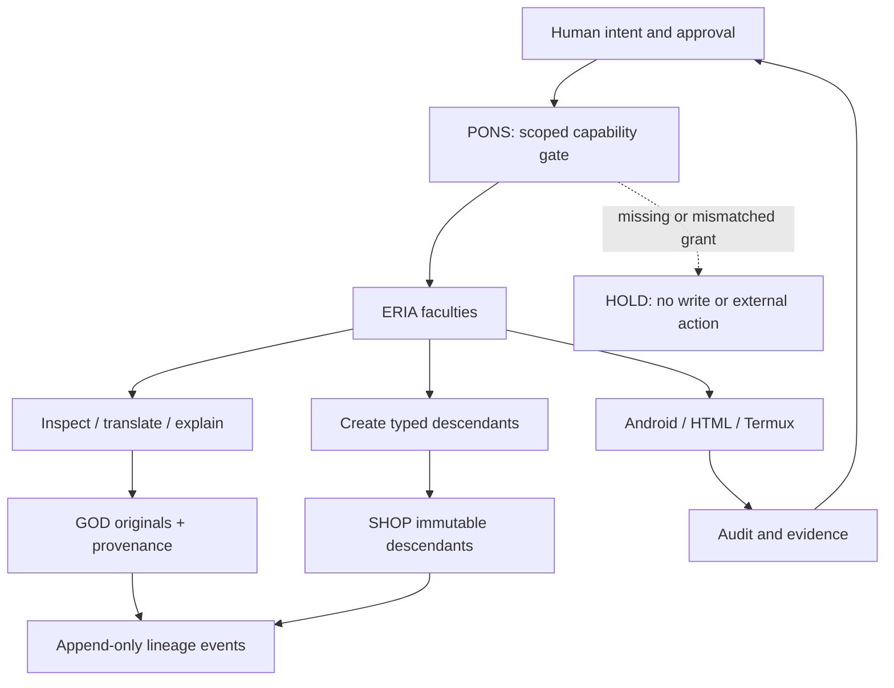

# ERIA Living Codex

> **Edition:** 1 — 2026-11-14  
> **Repository:** `Vanellye/CodEXgen` (ERIA identity migration)  
> **Observed ref:** `god/heritage-lineage`  
> **Observed commit:** `73cf168357dd3cfaab47f967510b826be98a872a`  
> **Status:** evidence-based snapshot; not a claim that every branch is integrated or operational.

## Purpose and reading key

This is the evolving English navigation and governance codex for ERIA. It describes faculties, branch families, interfaces, ethical boundaries, and evidence status. Each revision must preserve the previous edition and identify its source commit.

- **Verified:** directly supported by inspected source or repository metadata.
- **Inferred:** cautiously interpreted from a branch name; not proof of implementation.
- **Proposed:** intended capability without demonstrated runtime evidence.
- **Unknown:** evidence not yet inspected or insufficient.
- **HOLD:** missing, expired, mismatched, ambiguous, or unverified authorization.

## Chapter 1 — Identity and governing ethic

ERIA is the canonical project identity while the repository remains `Vanellye/CodEXgen` to preserve clone URLs, issues, pull requests, and provenance references. The Android namespace and application ID are `com.vanellye.eria`. The README warns that older `com.vanellye.codexgen` installations are a distinct app identity.

The governing ethic is stewardship:
1. Preserve human purpose and agency.
2. Preserve original bytes, Git history, and source provenance.
3. Test claims against evidence and make uncertainty visible.
4. Keep consequential automated actions accountable to people.
5. Require explicit, scoped authorization for writes, transmission, deployment, and hardware actions.
6. Prefer reversible proposals and isolated descendants over destructive mutation.
7. Never infer consent, truth, identity, or safety from a branch name or generated output.

## Chapter 2 — Architecture map

This is an information-flow model, not proof of a running deployment. PONS is an application-level gate, not an OS sandbox, cryptographic identity provider, or permission bypass.

## Chapter 3 — Faculties

### 3.1 Perception and repository understanding
**Purpose:** inspect repository structure, source files, metadata, and relationships without executing scanned code.  
**Outputs:** inventories, maps, evidence-linked summaries, and unresolved questions.  
**Ethics:** read-only by default; explicit source selection; no hidden network calls or untrusted code execution.  
**Evidence:** `GOD/README.md` identifies `tools/eria_repository_forge.py` as an on-demand read-only structural inventory tool.

### 3.2 Translation and intellectual interpretation
**Purpose:** explain code and data in plain English while retaining source identity and byte-level provenance.  
**Outputs:** translations, explanations, indexes, and interpretations as new derived records.  
**Ethics:** never silently replace original files; retain source path and digest; mark translations as interpretations, not authoritative facts.  
**Status:** translation workstreams appear in branch inventory; complete runtime coverage is not established.

### 3.3 Memory and preservation — GOD
**Purpose:** preserve original records and connect derived knowledge to ancestry.  
**Observed stores:** `ORIGINAL_DATA/objects/`, `SOURCE_PROVENANCE/records/`, and `LINEAGE/events.jsonl`.  
**Record facts:** stable record ID, SHA-256, byte length, media type, capture time, source metadata, parent IDs, and authority marker.  
**Ethics:** original bytes are immutable; unknown metadata remains unknown; corrections become descendants; Git branches are not archival backups.  
**Status:** ingestion and verification library code is documented; it is not an unattended directory watcher or fully connected ERIA runtime service.

### 3.4 Derivation and correction — SHOP
**Purpose:** store every non-original typed output as a new immutable object.  
**Requirements:** typed record identifier; at least one direct parent; derivation manifest; validated parent proof; source context; content hash and byte length.  
**Ethics:** never edit an ancestor; revalidate ancestry before accepting provenance; mark derived material `derived-not-validated-as-fact`.

A digest proves byte identity relative to captured bytes. It does not prove truth, safety, completeness, or authorization.

### 3.5 Authorization and dependency governance — PONS
**Purpose:** register explicit service dependencies and gate scoped capabilities.  
**Observed code:** `CapabilityGrant` checks capability, exact requested scope, exact approved scope, non-empty approval reference, and adapter verification. `Pons.authorize` returns `HOLD` for absent or mismatched grants and `PROPOSAL_ONLY` for a matching grant.  
**Limits:** the source explicitly says PONS is not an OS sandbox or cryptographic verifier.  
**Ethics:** no implicit grants, arbitrary host shell, root escalation, permission bypass, or hidden action.

### 3.6 Oprozal — advisory faculty
**Purpose:** propose advice or reactions when information is missing, conflicting, or incomplete.  
**Ethics:** label advice as a proposal; surface uncertainty and missing evidence; do not mutate state autonomously.  
**Status:** branch names indicate design and runtime workstreams; complete integration is not certified by this edition.

### 3.7 Interface faculty
- **Android:** application identity `com.vanellye.eria`; README specifies JDK 17 and Android SDK platform 35 for building. Debug APK is not a production-signed release.
- **Termux:** documented command: `python tools/eria_conversation_server.py . --port 8765`. The deployment notes describe loopback/local-device operation, not remote deployment.
- **HTML/transmission:** README links a local-only transmission interface with explicit per-transmission human authorization and an exportable session audit.
- **Ethics:** interfaces expose capability and status; they do not override authority boundaries.

### 3.8 Engineering, packaging, and execution
**Purpose:** validate, build, package, and stage approved changes.  
**Ethics:** exact target, immutable commit, least privilege, preflight checks, checksums, health verification, rollback, and audit evidence.  
**Status:** `docs/ERIA-DEPLOYMENT-PATHS.md` says no production host, TLS endpoint, service manager, health URL, rollback mechanism, or deployment credential is configured.

## Chapter 4 — Ethical release gates

A consequential action requires:
- Known actor and exact target.
- Named paths, commit, and operation.
- Explicit, current, scoped, independently verifiable authorization.
- Preserved source provenance and hashes.
- No silent overwrite of original records or historical refs.
- Appropriate, isolated, authorized tests.
- Separate approval for transmission, device activation, deployment, and publication.
- **HOLD** on failure, ambiguity, missing evidence, or expired approval.

## Chapter 5 — Branch atlas

Branch names were observed through the GitHub branches API. The descriptions below are conservative interpretations unless supported by inspected source. Branch existence does not prove implementation, integration, tests, deployment, or approval.

### Core and integration
- `main` — historical/default line; protect it and use only reviewed integration.
- `core` — proposed shared integration line; candidate, not automatically authoritative.
- `anchor/eria-unified-b549dea` — unified integration anchor snapshot; inspect its tree before treating it as canonical.
- `brethren` and `falsehood` — observed at the same anchor commit in the API snapshot; names alone imply no runtime capability.
- `god/heritage-lineage` — current working line for preservation, typed descendants, lineage validation, and deployment packaging paths.

### Feature and faculty development
- `eria/oprozal-hybrid-faculty` — Oprozal advice/reaction design.
- `eria/oprozal-hybrid-faculty-runtime` — runtime-oriented Oprozal workstream; inspect adapters and execution boundaries.
- `feature/aie-engineering-approval-workbench` — approval-controlled AI engineering workbench.
- `feature/eria-higher-faculty-inspection-2026-11-14` — higher-faculty inspection workstream.
- `feature/higher-faculty-code-translation-2026-11-14` — code-to-English translation workstream.
- `feature/eria-filesystem-understanding` — filesystem understanding and representation.
- `feature/eria-filesystem-download-export` — filesystem export and downloadable outputs.
- `feature/eria-canonical-conversion-engine` — canonical conversion and transformation.
- `feature/eria-correction-lineage-runtime` — correction descendants and lineage-aware runtime.
- `feature/eria-automated-file-pull-2026-11-14` — source ingestion automation.
- `feature/eria-conversation-html-repair` — conversation interface repair and safe HTML/text handling.
- `feature/eria-os-sandbox-evolution` — OS isolation and sandbox boundary.

### Pantheon and PONS
- `eria/new-pantheon-staging` — Pantheon staging/integration.
- `eria/pantheon-cpp-runtime-copy` — C++ runtime port or parallel implementation; semantic parity needs tests.
- `eria/pantheon-runtime-review-gate` — runtime review and authorization gate.
- `pantheon/source-digest-engine` — source digest and identity/provenance.
- `eria/otto-external-action-gates` — external action boundary and authorization.
- `eria/pons-avs-validation` — PONS approval validation and audit boundary.

### Governance, security, and reconciliation
- `governance/eria-evidence-execution-boundary` — separates evidence gathering from execution.
- `governance/eria-human-approval-gate` — human approval controls.
- `governance/eria-manifest-energy-fusion-bash` — manifest/shell workflow proposal; inspect for side effects.
- `security/red-write-only-ethical-tools` — security and write-boundary tools; inspect exact scopes and audit.
- `reconcile/lineage-governance` — lineage/governance reconciliation.
- `reconcile/pantheon-integration-core` — Pantheon contract reconciliation.
- `reconcile/transmission-metadata` — transmission metadata reconciliation.
- `review/two-snapshot-synthesis` — compare snapshots while preserving distinctions.
- `review/legacy-syntax-quarantine` and `repair/quarantine-legacy-python-syntax` — legacy syntax review/quarantine.

### Interfaces, hardware, and sensing
- `transmission` — transmission interface; opt-in, scoped, auditable.
- `reconcile/eria-hardware` — hardware boundary reconciliation; no activation inferred.
- `eria/witness-noise-actuator` — actuator/noise observation; hardware requires separate safety and authorization gates.
- `eria/suspension-thread-player-adapter` — player/adapter workstream; verify runtime contract.
- `eria/earth-sacral-lift-domain` — domain-specific workstream; branch name is not evidence of physical or biological effects.
- `eria/water-flow-workstreams` — water-flow domain; validate source data, units, and assumptions.
- `eria/multiomics-format-adapters` — multi-omics format adapters; not a clinical validation claim.

### Research, narrative, and archival
- `fiction-body`, `fiction-mind`, `fiction-creation` — narrative streams; label as fiction, not implementation evidence.
- `hypotheticals` — hypothetical scenarios; do not present as tested behavior.
- `archive/ashes-before-main-sync-2026-11-13`, `archive/eria-original-anchor-core-2026-11-13`, `archive/justly-11-merge`, `archive/main-before-1999-timestamp`, `archive/main-before-ash-sync-2026-11-13` — historical snapshots for comparison.
- `work/ashes-main-integration-2026-11-13` — integration work snapshot; review before reuse.
- `compile-copy/2026-11-13` — compilation/copy snapshot; verify lineage before use.

Other observed labels include `2cce11ɣ`, `GOD`, `Vanellye-patch-1`, `automation/android-dependency-updates`, `build-speed`, `cognitive-layer-2`, `docs/acoustic-branch-directory`, `docs/eria-code-to-english-index-2026-11-14`, `docs/star-glyphic-filesystem`, `edify`, `fix/main-water-ic-verification`, `mold`, and `zero-dissipation-anchor`, plus proposal and experimental refs. These are catalogued, not endorsed. The branch inventory is not a semantic inspection of every remote ref.

## Chapter 6 — Branch stewardship

- Preserve `main`; do not rewrite or force-update it.
- `god/heritage-lineage` is broad and diverged from `main`; do not merge it wholesale.
- Integrate through focused, reviewable branches and pull requests.
- Retain archive branches as historical evidence.
- Separate fiction and hypotheticals from factual implementation.
- Update branch descriptions only after inspecting branch contents and history.

## Chapter 7 — Build, test, package, deploy

Keep four states distinct: source validation, build artifact, device installation, and production deployment. The deployment-path document describes a packaging workflow intended to run syntax/schema/shell checks, build an unsigned Android debug APK, package Termux source, and emit checksums plus a manifest. It does not install on a device or deploy a production server.

The eight GOD parent-validation tests run in this conversation passed in an isolated local reproduction of inspected source and test cases. This was not a GitHub Actions run, not a full checkout-based suite, and not proof that all repository tests pass.

## Chapter 8 — Living update protocol

This page is not self-updating merely because it is called “living.” Evolution must follow a controlled cycle:
1. Observe refs, commits, files, workflows, and test evidence at a named timestamp.
2. Record a source manifest: ref, commit SHA, path, blob SHA, and observation time.
3. Compare with the prior Codex edition.
4. Draft additions as a new edition; never silently rewrite prior editions.
5. Label statements verified, inferred, proposed, fiction, or unknown.
6. Generate Markdown and PDF from one structured source.
7. Validate links, diagram syntax, hashes, and factual consistency.
8. Obtain human review before publication or repository changes.
9. Append a changelog event with prior/new edition hashes, source commit, reviewer, and approval reference.
10. Retain prior PDFs and manifests.

Suggested cadence: update faculty/branch maps after reviewed feature integration; update test and release evidence for each release candidate; update ethics after governance changes; reconcile stale branch descriptions on a scheduled review.

## Chapter 9 — Evidence ledger

| Item | Evidence state |
|---|---|
| ERIA identity and Android package | Verified in README |
| GOD originals/provenance/SHOP contract | Verified in GOD documentation |
| PONS exact-scope grant semantics | Verified in inspected source |
| Parent ancestry and hash validation | Verified in source; 8 isolated tests passed |
| Read-only repository forge description | Verified in GOD README |
| Android build recipe | Documented; no successful build claimed |
| Termux local server command | Documented; no live device deployment verified |
| Production server deployment | Not configured |
| All branches semantically inspected | No |
| All faculties integrated and operational | Not established |
| Main modified by this edition | No |

## Source map and changelog

Primary inspected sources: `README.md`, `ERIA_CORE.md`, `EDIFY.md`, `GOD/README.md`, `GOD/SHOP/README.md`, `tools/eria_pantheon/pons.py`, `tools/god_collective.py`, `tools/god_parent_validation.py`, and `docs/ERIA-DEPLOYMENT-PATHS.md`, plus the GitHub branches API snapshot.

**2026-11-14 — Edition 1:** created from inspected `god/heritage-lineage` documentation/source and branch inventory. No code, merge, deployment, or change to `main` is authorized by this documentation.
