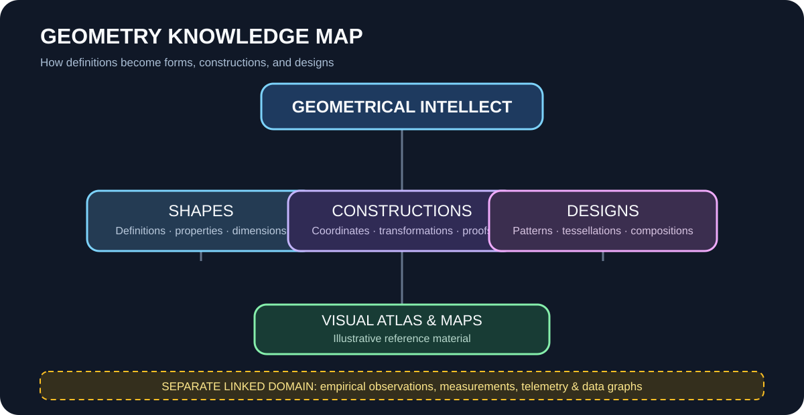
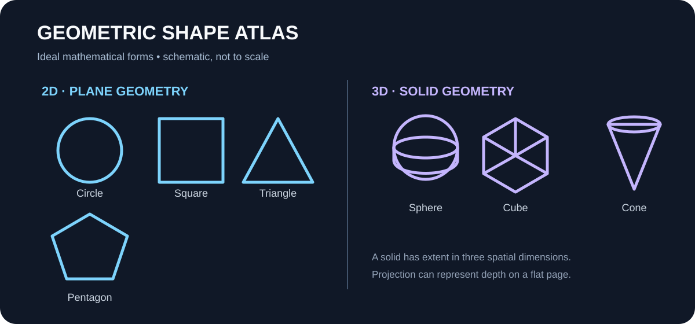
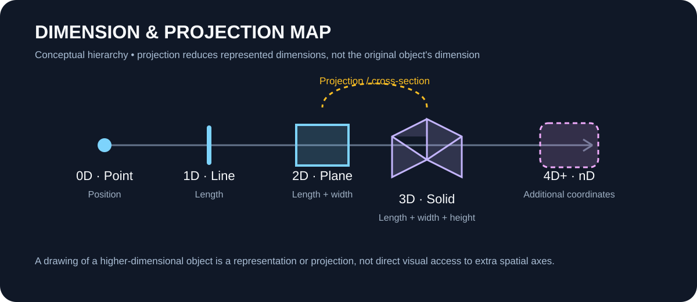

# Geometry & Design

This folder is the home for **geometrical knowledge and constructive design**: definitions, reasoning, shape studies, spatial relationships, diagrams used to explain an idea, and designs derived from geometric principles.

It is intentionally separate from measurement records, telemetry, charts of observed data, and other empirical graphs. Those belong with the relevant observation or experiment documentation. A geometric illustration explains a structure; an observation graph reports recorded evidence. Do not mix the two without labeling them clearly.

## Organization

| Area | Put these materials here |
|---|---|
| [Intellect](intellect/README.md) | Definitions, axioms, questions, derivations, proofs, interpretations, and design rationale |
| [Shapes](shapes/README.md) | Shape definitions, properties, classifications, dimensions, symmetry, and geometric constructions |
| [Designs](designs/README.md) | Compositions, tessellations, patterns, spatial layouts, visual systems, and reusable design studies |
| [Visuals](visuals/README.md) | Picture atlas, dimension maps, concept maps, and explanatory SVG diagrams |

## Visual overview

### Geometry knowledge map

### Shape atlas

### Dimension and projection map

These are explanatory illustrations, not measured data. The dimension map is a conceptual guide; a projection of a higher-dimensional object is not the object itself.

## Document principles

1. Separate established mathematics from conjecture, interpretation, and artistic exploration.
2. Define symbols, units, coordinate systems, assumptions, and dimensions.
3. Include construction steps or derivations when a result depends on them.
4. Label diagrams as conceptual, mathematical, illustrative, or measured.
5. Keep measured datasets and statistical plots in their own observation/research area; link to them when they inform a design.
6. Record sources and revision context for borrowed theorems, methods, or designs.
7. Give every visual a title, a short description, and a link to the document it explains.

## Suggested document structure

~~~text
# Document title
## Purpose
## Definitions and notation
## Assumptions
## Construction or reasoning
## Properties / results
## Diagram references
## Evidence status: established | derived | conjectural | illustrative
## Sources and revision notes
~~~

## Scope boundary

This is a knowledge and design library, not a sensor dashboard or results archive. A shape may be described mathematically here; measurements of a physical instance, its uncertainty, and plots of collected values remain with the corresponding observation record.

Add new topics under the closest area and update this README when the taxonomy changes.
