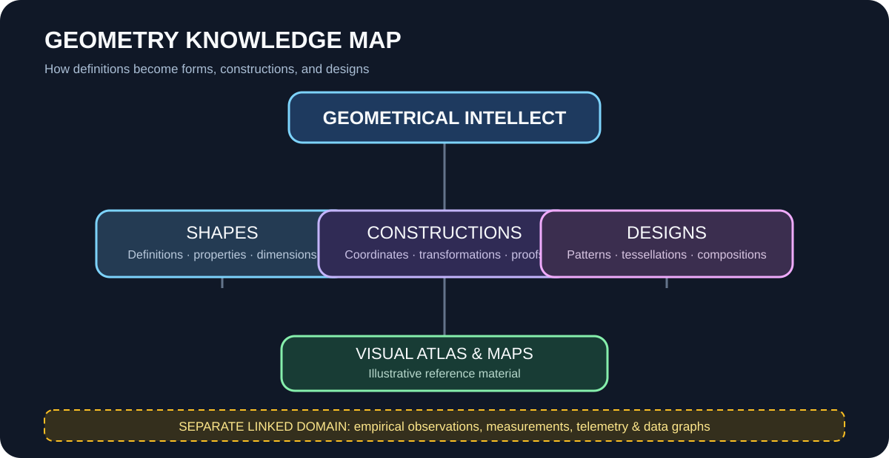
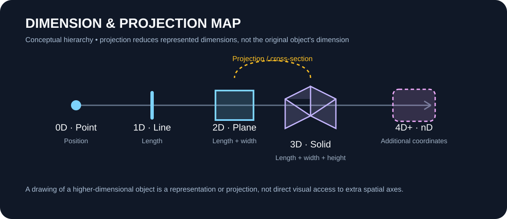

# Geometrical Designs

Store constructive and visual work built from geometric ideas: compositions, patterns, tessellations, grids, spatial layouts, diagrams, and reusable design systems.

## Design and concept map

These maps show relationships between areas of study. They are navigation aids and conceptual illustrations, not empirical graphs or claims that higher spatial dimensions are directly observable.

## Suggested organization

- **Patterns:** repetitions, tilings, tessellations, and ornamental systems.
- **Compositions:** proportion, balance, alignment, hierarchy, and spatial relationships.
- **Structures:** modular arrangements, grids, frameworks, and form studies.
- **Diagrams:** explanatory geometry, construction sequences, and conceptual maps.

## Design record

Describe the intent, geometric basis, constraints, construction steps, dimensions or scale, variants, and intended use. Identify whether each image is a mathematical construction, conceptual illustration, or aesthetic exploration.

Keep empirical charts and plots of observed data outside this folder. When a design is informed by measured results, cite or link to the separate source record.
