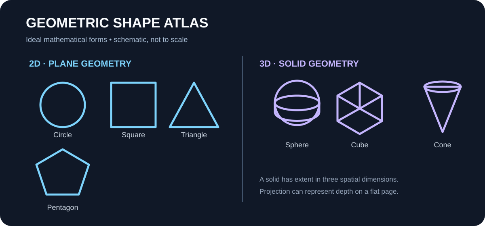
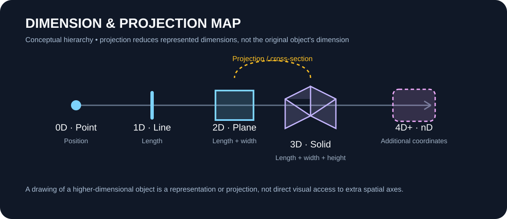
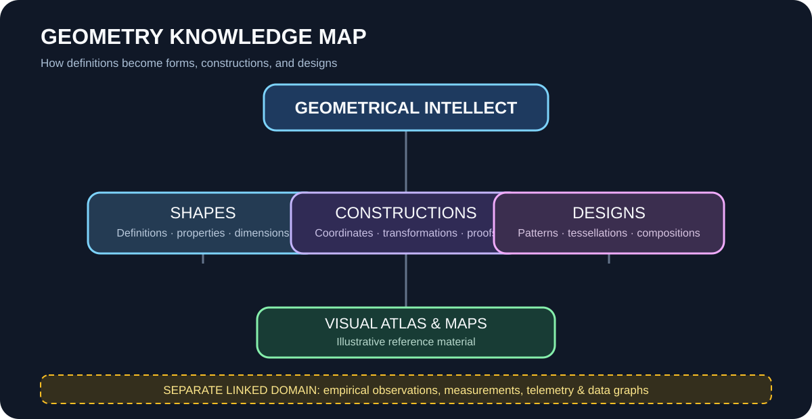

# Geometry Visuals

A small reference gallery of explanatory vector illustrations for the Geometry & Design library.

## Gallery

### Shape atlas

### Dimension and projection map

### Geometry knowledge map

## Asset notes

- SVG files are scalable and editable as text-based vector graphics.
- These images are conceptual or mathematical illustrations, not measured datasets.
- Shapes are schematic and may not be drawn to scale.
- Higher-dimensional forms are represented through projections, diagrams, or coordinate descriptions; the pictures do not imply direct perception of additional spatial axes.
- Keep observation charts, sensor traces, and experimental plots in their own research/observation area.
