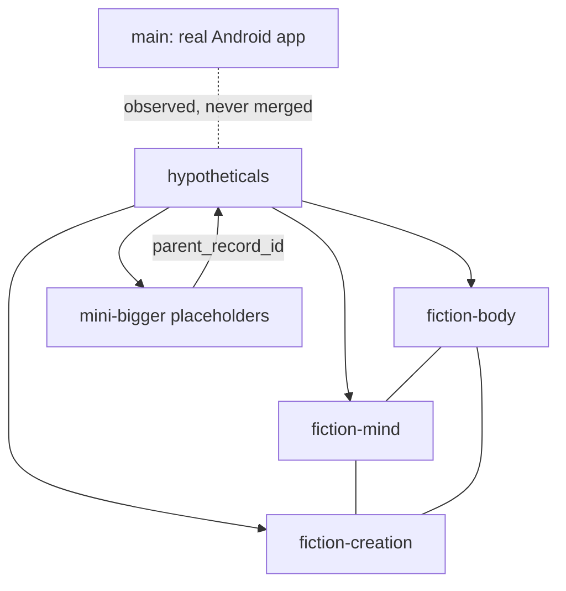

# The Bridge (fiction map)

A geometric map of the hypotheticals ecosystem. `main` is the real app and is
never merged with fiction; the bridge only shows where things stand.

The three fiction branches form a triangle around `hypotheticals`; `main`
sits outside it, connected by a dotted line only.

## Mini-bigger hypothetical records

`python/hypothesis_fragments.py` defines small placeholder records for parts
of a larger hypothetical entity. Each record carries a stable `record_id`,
a `parent_record_id`, a label, a description, and source/timestamp provenance.

These records are structural references, not evidence or executable code.
Their envelopes remain `UNKNOWN`, `not_empirical_evidence`, and
`not_authorized`; runtime injection is explicitly disallowed. A mini-bigger
cannot name itself as its own parent. Parent links do not imply that the parent
record exists or has been validated; a catalog-level referential-integrity
check is still required before treating a collection as complete.
