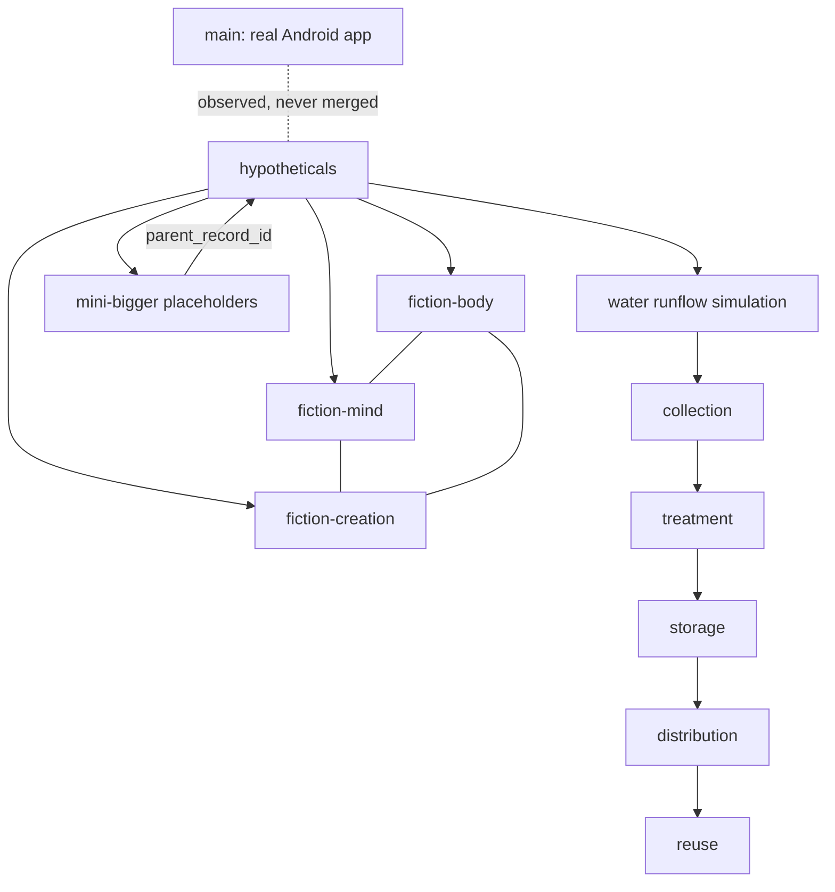

# The Bridge (fiction map)

A geometric map of the hypotheticals ecosystem. `main` is the real app and is
never merged with fiction; the bridge only shows where things stand.

The three fiction branches form a triangle around `hypotheticals`; `main`
sits outside it, connected by a dotted line only.

## Mini-bigger hypothetical records

`python/hypothesis_fragments.py` defines small placeholder records for parts
of a larger hypothetical entity. Each record carries a stable `record_id`,
a `parent_record_id`, a label, a description, and source/timestamp provenance.

These records are structural references, not evidence or executable code.
Their envelopes remain `UNKNOWN`, `not_empirical_evidence`, and
`not_authorized`; runtime injection is explicitly disallowed. A mini-bigger
cannot name itself as its own parent. Parent links do not imply that the parent
record exists or has been validated; a catalog-level referential-integrity
check is still required before treating a collection as complete.

## Water runflow

`python/water_runflow.py` models a data-only sequence of collection,
treatment, storage, distribution, and reuse. Each step is a provenance-bearing
record linked to the preceding step. Partial flows are allowed; stage order and
parent continuity are checked.

This is a simulation and record-keeping contract only. It does not connect to
sensors, pumps, valves, treatment equipment, or external services. Recorded
quality observations are not interpreted as proof of potability. All records
remain `UNKNOWN`, unvalidated, and `not_authorized`; physical actuation and
potability determination are explicitly disabled.

## Water equipment inventory

`python/water_equipment.py` defines metadata-only inventory records for pumps,
valves, sensors, and treatment equipment. A connection may be recorded as
`reported_connected`, but that is an inventory assertion only: no device
driver, network transport, command path, or external I/O is present. Every
record explicitly keeps `control_enabled`, `potability_claim_allowed`, and
`external_io_performed` false. Calibration references may be recorded for
traceability, but their presence does not validate calibration or water quality.

Equipment connection metadata does not change the WATER runflow's
simulation-only, non-authorizing status. Physical actuation and potability
determination remain disabled.

## IC verification workstreams

`python/ic_verification.py` keeps the two meanings of IC separate:

1. **Instrument Connection** checks: identity/tagging, wiring and pinout,
   protective earth/isolation, loop continuity, signal range/scaling,
   communications/protocol, calibration traceability, alarm/fault behavior,
   and fail-safe state.
2. **Integrated Circuit** checks: part identity/revision, package pinout,
   power rails/sequence, supply current, clock/reset, logic function,
   timing constraints, interface compatibility, and thermal/operating limits.

Each verification record identifies its subject, check, method, evidence
references, outcome, and reviewer. A PASS requires evidence references and an
independent reviewer; it applies only to that specific check. The summary
reports missing and non-passing checks and never grants release authority.

These are verification-record contracts, not hardware test drivers. No
instrument is connected, no circuit is energized or programmed, and no
physical test is performed by this code. Instrument verification does not
establish water potability. Equipment actuation, product release, and water
potability remain separate authorization decisions.
