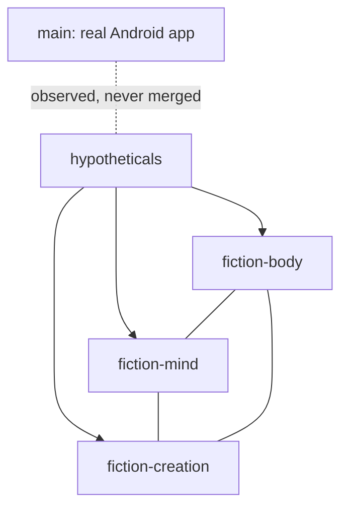

# The Bridge (fiction map)

A geometric map of the hypotheticals ecosystem. `main` is the real app and is
never merged with fiction; the bridge only shows where things stand.

The three fiction branches form a triangle around `hypotheticals`; `main`
sits outside it, connected by a dotted line only.
